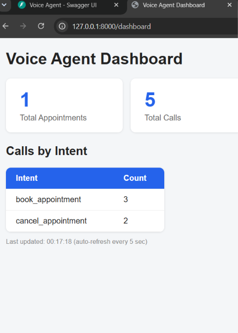

# Voice Agent

A backend for an AI voice agent that handles appointment calls. It saves calls, detects the caller's intent, and shows live analytics on a web dashboard.

## Features

- Save call records through an API
- Automatic intent detection (book_appointment, cancel_appointment)
- Analytics route that counts appointments, calls, and calls per intent
- Web dashboard that refreshes every 5 seconds

## Tech Stack

Python, FastAPI, SQLAlchemy, SQLite, HTML, CSS, JavaScript

## How to Run

```bash
pip install fastapi uvicorn sqlalchemy
uvicorn app.main:app --reload
```

Open http://127.0.0.1:8000/dashboard to see the dashboard.

## Main Routes

- POST /calls : save a new call
- GET /calls : list all calls
- GET /stats : totals and calls by intent
- GET /dashboard : live dashboard
- GET /docs : API documentation

## Dashboard Preview

